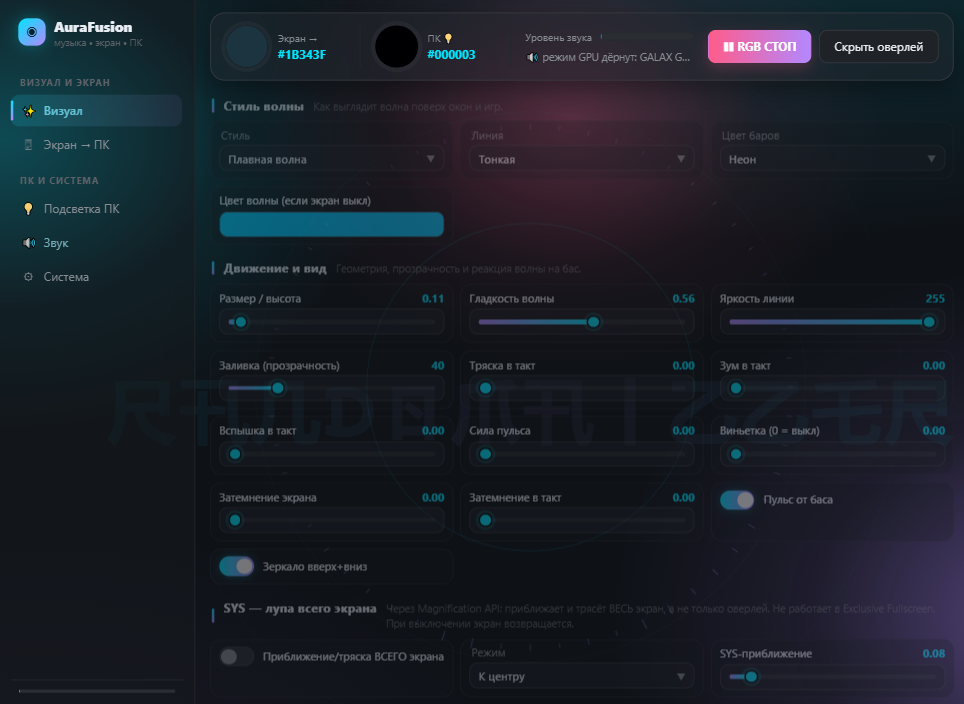
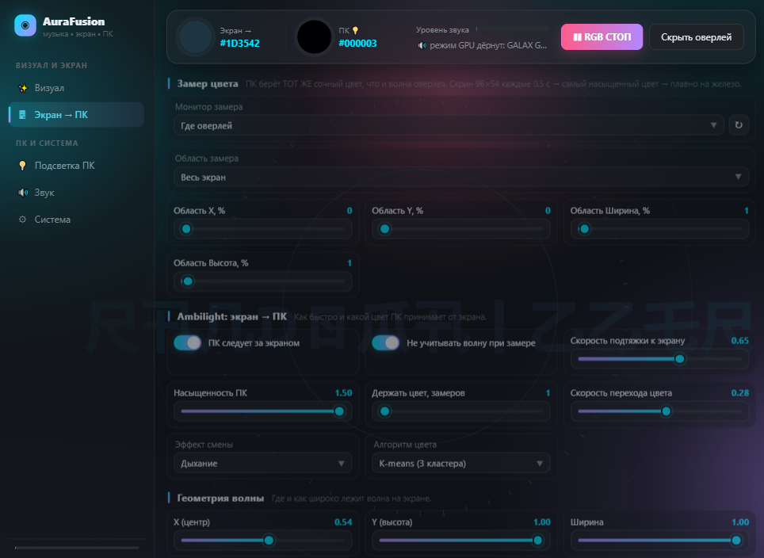
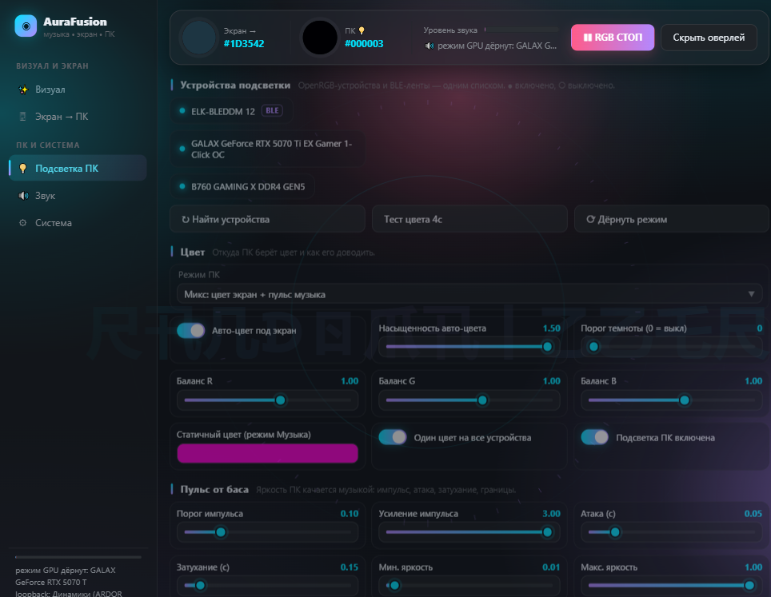
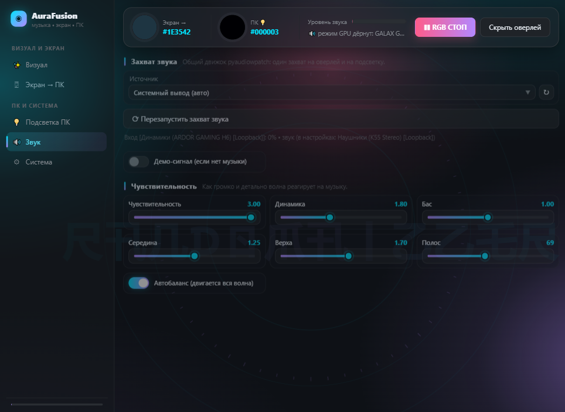
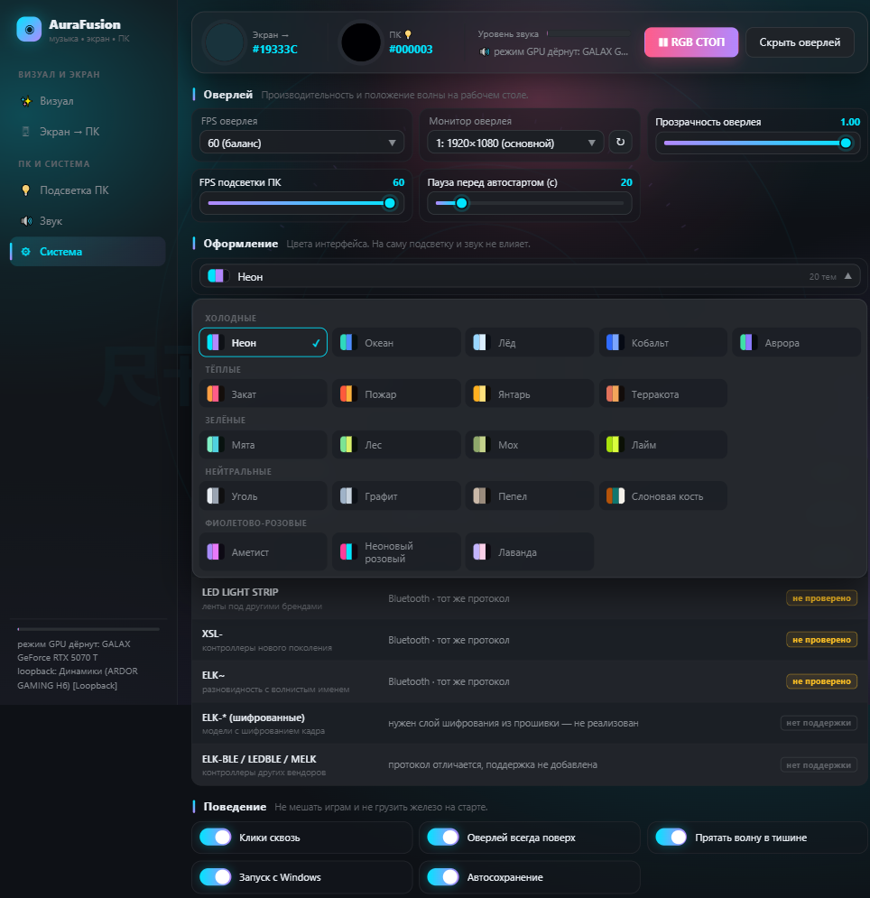

<div align="center">

# AuraFusion

**Подсветка ПК и экранный оверлей, которые живут музыкой и картинкой**

Звук снимается напрямую с выхода колонок, цвет — с пикселей экрана,
и всё это уходит в RGB-подсветку корпуса, ленту по краю и оверлей поверх игр.

`Windows` · `Python 3.10+` · `без облаков и подписки`

</div>

---

## Скриншоты

### Визуал — оверлей поверх игры и экрана



### Экран → ПК — цвет берётся с пикселей экрана



### Подсветка ПК — устройства, зоны, режимы



### Звук — устройство захвата и чувствительность



### 20 тем оформления



---

## Что это

AuraFusion совмещает три вещи, которые обычно живут в трёх разных программах:

| | |
|---|---|
| **Визуализация** | Оверлей поверх игр и рабочего стола: полосы спектра, волна, круги. Рисуется поверх окон, не мешает кликам. |
| **Экран → ПК** | Цвет подсветки снимается с пикселей экрана — Ambilight, но работающий с любой игрой и без захвата окна. |
| **Подсветка ПК** | Управление всем, что говорит на OpenRGB: материнка, видеокарта, вентиляторы, ленты. Плюс BLE-ленты по Bluetooth. |

Два источника цвета смешиваются по весу: `mix` (экран + пульс музыки), `screen` (только экран) или `music` (только музыка).

---

## Возможности

### Визуализация
- 16 стилей фигуры: `smooth` (волна), `bars` (бары), `peak` (пики),
  `particles` (частицы), `sparks` (искры), `orbs` (шарики), `mesh` (сетка),
  `stack` (слои), `fill` (заливка), `ribbon` (лента), `circle` (круг),
  `arc` (дуга), `spiral` (спираль), `radial` (кольца), `rays` (лучи),
  `combo` (бары+волна)
- **Искры** — фонтан по всей площади: частицы вылетают из-под базовой линии
  вверх по всей ширине и гаснут на пике, ничего не падает обратно. Пока играет
  музыка, по всей площади идёт слабый фон; притом он зависит от общей
  громкости, а не от баса, поэтому фонтан есть и на музыке без низов
- У искр три отдельных ползунка:
  - **Скорость** (0.05–4.0) — базовая скорость подъёма; меняет и время жизни,
    быстрые искры взлетают выше и гаснут раньше
  - **Разгон на частоте** (0–6) — насколько колонка разгоняется там, где
    поднимается своя частота. На нуле все летят одинаково, на 1 своя колонка
    уходит примерно вдвое выше остальных, на 3 — втрое
  - **Плотность** (0.15–4.0) — сколько частиц одновременно в воздухе
  Место вылета выбирается по весу, равному высоте спектра, а размер зависит
  от полосы, из которой частица вылетела. Высота задаёт плотность, но не
  само наличие: у тихих полос искры мелкие и низкие, но они есть
- **Свечение искр** — ореол вокруг частицы, аналог CSS-овского
  `filter: drop-shadow`. В браузере это одна строка, в Qt приходится
  рисовать тремя проходами от широкого слабого ореола к самой точке.
  Два ползунка задают, где по высоте полёта ореол горит: «Свечение снизу»
  и «Свечение сверху». По умолчанию горит внизу и гаснет к вершине; если
  поднять «снизу» выше, чем «сверху», искры внизу будут чистыми, а
  загорятся только у верха. Ноль свечения возвращает одиночную отрисовку.
  Потолок 300: 100 — умеренный ореол, 300 — широкий светящийся шлейф.
  Считать в уме: на 1920×1080 при 380 частицах выходит 202 fps без
  свечения, 100 при 1.0 и 52 при 3.0, так что на максимуме лучше снизить
  плотность
- **Детектор темпа.** Искры и пульс бьют по ритму, а не по порогу громкости.
  Темп ищется автокорреляцией огибающей спектра в диапазоне 60–190 BPM: берутся
  локальные максимумы корреляции, и кандидат выбирается голосованием — сколько
  реальных ударов сходится с его фазой. На белом шуме и ровном гуле темп не
  определяется вовсе, пульсаций не выдумывается
- **Значок в трее** (веб-версия): открыть панель, спрятать/показать оверлей,
  остановить всё. Без него процесс с панелью в браузере было нечем закрыть,
  кроме диспетчера задач. Значок рисуется кодом, файлов не нужно
- Оверлей не залезает на панель задач: на автоскрытии она выезжает под
  оверлей и кажется, что не поднялась. Отключается настройкой
  `avoid_taskbar` (в веб-панели — «Не залезать на панель задач»). Сколько
  пикселей уступает оверлей — константа `TASKBAR_KEEP` в `ui/overlay.py`,
  сейчас это 1 px (панель поднимается и при этом фигура прижата к низу)
- Фигуры реагируют на цвет: `shape_color` переключает «как на экране» (цвет
  берётся с экрана, как у волны), «палитра, подкрашенная экраном» или
  «своя палитра». Если «Экран → ПК» выключен, оба живых режима откатываются
  в палитру
- **Настройки у каждой фигуры свои.** У круга, дуги, спирали, колец и лучей
  есть центр на экране и размер фигуры, у фигур на базовой линии — ширина и
  координаты по краям. В панели показываются только уместные для выбранного
  стиля настройки, остальные прячутся вместе с секцией, а если в секции не
  осталось ничего живого — прячется и она. Значения хранятся отдельно для
  каждой фигуры в `style_settings`, поэтому переключение туда-обратно ничего
  не затирает. Что какая фигура умеет, описано в `ui.overlay.style_keys`
- **У каждой фигуры своё число линий и своя плавность.** «Количество линий»
  (8–256) — это столбики у баров, спицы у круга, витки у спирали; «Плавность
  линий» (0–100) — от резких отдельных линий до сплошной формы. Раньше число
  линий было общим для всех фигур, а круг, лучи, кольца, дуга и спираль вообще
  не сглаживались. Считается одно число раз в кадр в `_fit_lines()`, поэтому
  оба ползунка работают одинаково для всех 16 фигур
- Размер фигуры («Размер / высота») опускается до 0.01 — совсем низкая и
  тонкая полоса, для тонкой настройки под конкретный экран
- Положение по вертикали считается от высоты **всего экрана**, а не окна
  оверлея. Иначе после уступа панели задач фигура целиком поднималась на
  освободившуюся полосу и ползунок «вниз» переставал означать низ
- 10 рисунков линии, включая градиент, двойную, пунктир, мега-свечение
- Раздельно выкручиваются бас / середина / верхи (ползунки усиления)
- Авто-баланс: чувствительность подстраивается под громкость, чтобы оверлей не прыгал
- Пульс на долю, тряска, зум, вспышка, виньетка, затемнение фона
- Режим системного эффекта: приближение и тряска **всего** экрана
- Скрытие по бездействию, клик сквозь окно, поверх всех окон
- Оверлей и цвет ПК можно вывести на **разные мониторы**

### Экран → ПК
- Замер по кадру: `juicy` (насыщенный акцент), `average`, `kmeans`
- Выбор области: весь экран, центр, верх, низ, своя доля экрана
- Автотяга цвета с настройкой скорости — без резких скачков
- Порог темноты: когда на экране темно, подсветка гаснет
- Дожим насыщенности, чтобы красный не выглядел розовым
- Отдельный баланс белого по каналам R/G/B
- Анти-мигание: оттенок держится N замеров подряд

### Подсветка ПК
- Любой RGB-контроллер, видимый OpenRGB — без плагинов и перезапуска сервера
- Отдельная зона и число светодиодов на каждое устройство
- Ключ `color_all` — «всё сразу» или по устройствам
- Авто-кик режима GPU на старте: лечит залипший Direct после перезагрузки
- Пульс по басу, сглаживание атаки/отпускания, гамма, минимальная яркость
- Простой автозапуск с задержкой, чтобы не мешать старту системы
- Обе границы яркости (минимальная и максимальная) сохраняются. Раньше обе
  стояли в списке целых чисел, и `int(0.31)` при загрузке давал ноль: ползунки
  крутились, но значение каждый перезапуск обнулялось. Дробные настройки
  теперь приводятся к float с проверкой диапазона, строковые (`static_color`)
  — отдельно, потому что `int(float("#C50DF1"))` падал и молча возвращал
  значение по умолчанию

### BLE-лента
Лента `ELK-BLEDDM` / `ELK-BLEDOM` подключается по Bluetooth и работает как
любое другое устройство подсветки — со сканером, выбором из списка и тем же
конвейером цвета.

- **Не нужен OpenRGB** — приёмник BLE живёт внутри `RGBEngine`, отдельным слоем
- Протокол разобран обратной разработкой: 9 байт `7E LEN CMD P1..P5 EF`, сервис `FFF0`, запись `FFF3`
- Кадры уходят **без подтверждения** (~1 мс против ~133 мс), поэтому поток держит 60 fps вместо 7
- Раз в 2.5 с идёт пин-кадр с подтверждением — чтобы лента не теряла связь
- Автопереподключение при обрыве

### Интерфейс
- Панель управления живёт в браузере: одна страница, пять разделов. Ничего
  ставить не нужно — сервер поднимает её сам на `127.0.0.1:8765`
- **Сцены** — именованные наборы настроек, переключаются одной кнопкой:
  Игра, Фильм, Работа, Вечеринка, Тишина, Выключить всё. Нажатие переносит
  сразу всё — режим цвета, силу эффектов, прозрачность оверлея, что включено.
  Сцены не трогают железо: ключи устройств, портов и автозапуска отсекаются,
  поэтому сценой нельзя выключить подсветку не там
- Голый HTTP + SSE на стандартной библиотеке, без фреймворков и сборки
- 20 тем оформления в выпадающем списке, каждая описана пятью цветами
- Фон реагирует на музыку: пятна, кольца по басу, штрихи спектра
- Настройки пишутся в конфиг автоматически
- **Значок в трее** — правый клик: открыть панель, спрятать или показать
  оверлей, остановить всё. Клик по значку тоже открывает панель. Выход
  идёт через `app.quit()`, то есть тем же путём, что `Ctrl+C`, со всеми
  очистками: конфиг сохранён, BLE-лента отпущена, RGB остановлен

---

## Установка

Нужен Python 3.10 или новее.

```bat
git clone https://github.com/RANDOMAIZZ/aurafusion.git
cd aurafusion
pip install -r requirements.txt
```

Зависимости:

| Пакет | Зачем |
|---|---|
| `PySide6` | оверлей (поверх окон) |
| `numpy` | FFT, разбор спектра, обработка кадров |
| `pyaudiowpatch` | захват звука через WASAPI loopback |
| `openrgb-python` | разговор с сервером OpenRGB |
| `bleak` | Bluetooth-ленты |
| `Pillow` | капчи, превью, фон |

OpenRGB ставить **не обязательно** — без него работают все, кроме USB-устройств.
Лента по Bluetooth работает вообще без него.

---

## Запуск

```bat
run_web.bat    панель в браузере
```

Или напрямую:

```bat
python web_main.py                     откроет браузер
python web_main.py --no-browser        без открытия браузера
python web_main.py --port 9000         другой порт
```

Панель поднимается на `http://127.0.0.1:8765/` и открывается сама.
Десктопной версии на PySide6 больше нет: держать две копии одного интерфейса
оказалось дороже, чем пользоваться браузером, а веб-вариант умел больше —
например, прятал настройки, неуместные для выбранной фигуры.

---

## Поддерживаемые устройства

### Через OpenRGB

| Тип | Что это | Статус |
|---|---|---|
| OpenRGB (универсальный) | материнка, видеокарта, корпусные вентиляторы, USB-ленты | работает |
| ELK-BLEDOM / ELK-BLEDDM | ваша BLE-лента | работает |
| ELK-BLEDOM | тот же контроллер | работает |
| LED LIGHT STRIP | ленты под другими брендами | не проверено |
| XSL | контроллеры нового поколения | не проверено |
| ELK~ | контроллер с волшебным именем | не проверено |
| ELK~ (шифрованные) | модель с шифрованием кадра | нет поддержки |
| ELK-BLE / LEDBLE / MELK | контроллеры других вендоров | нет поддержки |

Статус прямо виден в панели: вкладка **Система → RGB-устройства**.

### По Bluetooth

| Тип | Протокол |
|---|---|
| ELK-BLEDDM / ELK-BLEDOM | Bluetooth · FFF0/FFF3 · 9-байтный кадр |

---

## Настройки

Всё лежит в `fusion_config.json`, файл создаётся сам при первом запуске.
Ключевые параметры:

```jsonc
{
  "rgb_enabled": true,
  "rgb_mode": "mix",          // mix | screen | music
  "rgb_fps": 60,
  "dark_threshold": 0,        // порог темноты, 0 = выкл
  "follow_screen": true,      // главный тумблер «Экран → ПК»
  "color_algo": "juicy",
  "auto_speed": 0.6,
  "ble_enabled": true,
  "ble_scan_s": 8,            // сколько секунд сканировать ленты
  "ble_max_fps": 20,          // потолок частоты BLE-кадров
  "openrgb_host": "127.0.0.1",
  "openrgb_port": 6742,
  "web_theme": "neon"
}
```

Полный список с комментариями — в [`core/config.py`](core/config.py).

---

## Архитектура

```
                ┌──────────────┐
   звук  ──────▶│ audio_engine │  WASAPI loopback → FFT → бас/середина/верхи
                └──────┬───────┘
                       │
   экран  ──────▶┌──────▼───────┐        ┌───────────────┐
                │ screen_color │───────▶│   rgb_engine  │──▶ OrgbSink (OpenRGB)
                └──────────────┘        │               │──▶ BleSink (bluetooth)
                ┌──────────────┐        └───────────────┘
   оверлей ─────▶│ ui/overlay   │
                └──────────────┘

   панель:     webui/  (браузер)  ←→  web_main.py
```

- `core/audio_engine.py` — звук с колонок через WASAPI loopback, FFT, полосы
- `core/screen_color.py` — замер цвета с экрана, сглаживание, Ambilight-зоны
- `core/rgb_engine.py` — общий конвейер цвета, вёдра по устройствам, `OrgbSink` и `BleSink`
- `core/ble_strip.py` — протокол и транспорт BLE-ленты
- `ui/overlay.py` — оверлей; PySide6 нужен только ради него, панели на нём нет
- `webui/` — панель в браузере (vanilla JS + CSS, без сборки и фреймворков)

### Про BLE-транспорт

У ленты один нюанс: **одноцветный контроллер**. Прошивка не умеет команды
«поставить пиксель №7 в синий» — только «залить весь отрезок цветом RGB».
Поэтому градиента по ленте не будет: это ограничение железа, а не программы.
Проверено тремя независимыми разборами прошивки.

Второй нюанс: лента держит **одно** BLE-соединение. Пока открыт AuraFusion,
приложение на телефоне её не займёт.

---

## Ограничения

- **Только Windows.** Захват звука — WASAPI loopback, оверлей — PySide6 поверх окон.
- **Градиента по BLE-ленте нет** — контроллер одноцветный (см. выше).
- **Градиент по зонам ПК работает**, но каждый кадр уходит в несколько зон
  сразу, поэтому он заметно нагружает USB-контроллеры.
- Ленты с шифрованием кадра (`ELK~ шифрованные`, `MELK`) не поддерживаются —
  протокол другой.
- Ядро и слой BLE-сенсоров используют `numpy`, поэтому в определённых местах
  проверка пустого массива идёт сравнением, а не `not arr`.

---

## Структура

```
aurafusion/
├── web_main.py          точка входа: HTTP + SSE, трей, оверлей
├── run_web.bat
├── fusion_config.json   настройки (создаётся сам)
├── requirements.txt
├── core/
│   ├── audio_engine.py  звук и спектр
│   ├── screen_color.py  цвет с экрана
│   ├── rgb_engine.py    конвейер RGB, OrgbSink, BleSink
│   ├── ble_strip.py     протокол BLE-ленты
│   ├── openrgb_raw.py   низкоуровневый разговор с OpenRGB
│   ├── beat.py          детектор темпа и фазы доли
│   ├── scenes.py        готовые сцены и фильтр безопасных ключей
│   └── config.py        конфиг и значения по умолчанию
├── ui/
│   └── overlay.py       оверлей (PySide6 нужен только ради него)
├── webui/
│   ├── index.html
│   ├── app.js           страницы, контролы, SVG-фон
│   └── style.css        токены тем и сетка
├── tools/               стенды, см. «Разработка»
└── docs/screenshots/
```

---

## Разработка

Проверено на Windows 11, Python 3.14, материнка B760 GAMING X DDR4 GEN5,
GALAX GeForce RTX 5070 Ti, BLE-лента ELK-BLEDDM 12.

Проверить конвейер без GUI:

```bat
python -c "from core import rgb_engine; e = rgb_engine.RGBEngine(); print(e.devices)"
```

Отрисовку оверлея можно проверить вообще без запуска на своём экране —
рендер идёт через offscreen-платформу Qt, звук заменяется синтетикой:

```bat
python tools/shot_overlay.py
```

Скрипт кладёт в `.overlay_shots/` пять листов: все стили, все типы линии на
волне и на заливке, сочетания с зеркалом, сравнение режимов цвета фигур. После
этого прогоняет 560 кадров по всем сочетаниям «стиль × линия × зеркало», крайним
размерам спектра и рассинхрону спектра с палитрой — если в `paintEvent` есть
исключение, скрипт его напечатает.

Отдельно проверяется гостинг: два разных кадра рисуются на одном буфере, и
по пикселям видно, стёрся ли след первого. Полупрозрачное окно Qt не очищает
буфер сам, поэтому без явного затирания волна оставляет бесконечный хвост.
Скрипт печатает `GHOST=OK` или `GHOST=BUG`. Если оба кадра вышли пустыми,
печатается `GHOST=VACUOUS` и это считается провалом: иначе проверка проходит
вхолостую, ничего не проверяя.

Стенд гоняет кадры по виртуальным часам, а не по стенным. Физика искр и
инерция частиц считаются по времени, а кадры подряд идут за доли миллисекунды —
за 45 кадров проходило меньше сотни миллисекунд, частицы оставались лежать на
базовой линии, и стиль на листе выходил пустым.

Физика искр живёт в `tick()`, а не в `paintEvent`. В `paintEvent` частицы
двигаются только когда Qt удосужится перерисовать окно: оверлей скрыт
настройкой «прятать в тишине», окно свёрнуто или в фоне — и искры замирают
в воздухе, а потом разом срываются.

Искры проверяются отдельным стендом: он меряет, есть ли фон по всей площади
на тихой музыке и без баса, во сколько раз колонка со своей частотой уходит
выше остальных при разгоне, и сколько частиц в воздухе при разной плотности:

```bat
python tools\probe_sparks.py
```

Геометрия оверлея и панели задач — на живой машине, по настоящим окнам
процесса, а не расчётом:

```bat
python tools\probe_geom.py
```

Детектор темпа проверяется на двух уровнях. На синтетике с заданным BPM —
находит ли темп и не выдумывает ли его там, где ритма нет:

```bat
python tools\probe_beat.py
```

И внутри настоящего `Overlay.tick()` — попадают ли удары в ритм, с
сравнением со старым порогом по басу:

```bat
python tools\probe_beat_live.py
```

Панель проверяется отдельно — на живой копии, через настоящие запросы:

```bat
python tools\test_web_actions.py
```

Он жмёт «скрыть/показать оверлей» десять раз и меняет настройки с побочными
эффектами, замеряя каждый ответ. Без этого ловится зависание: Qt-виджет нельзя
трогать из потока HTTP-обработчика, иначе после второго нажатия сервер перестаёт
отвечать совсем.

Исчезновение фигуры ищется так — гоняем настоящий `tick` + `paintEvent` на
длинном меняющемся сигнале с паузами и тихими местами и меряем высоту фигуры
в каждом кадре:

```bat
python tools\find_fadeout.py 10
```