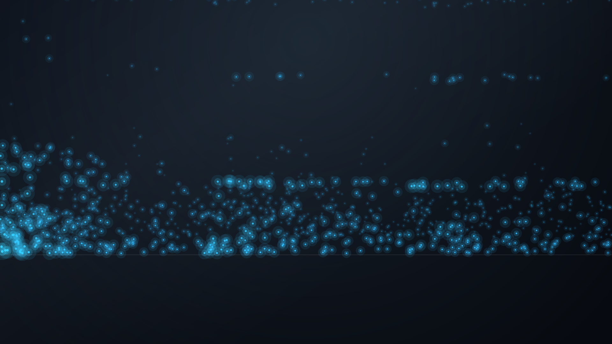
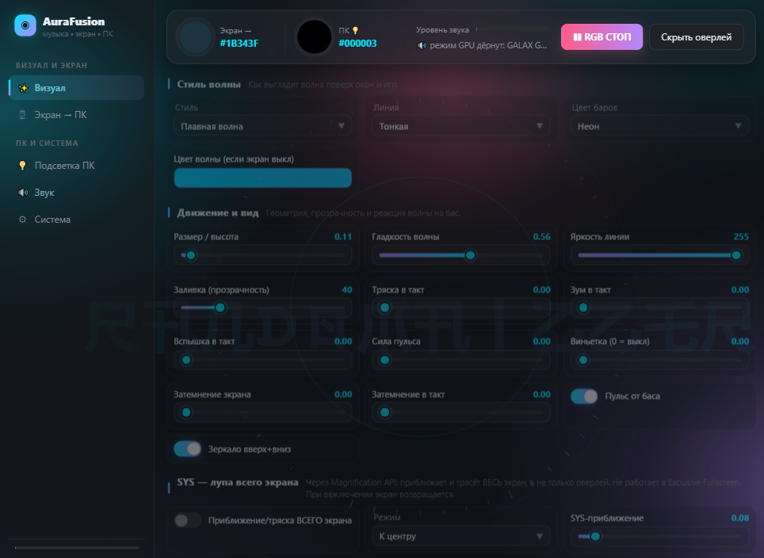
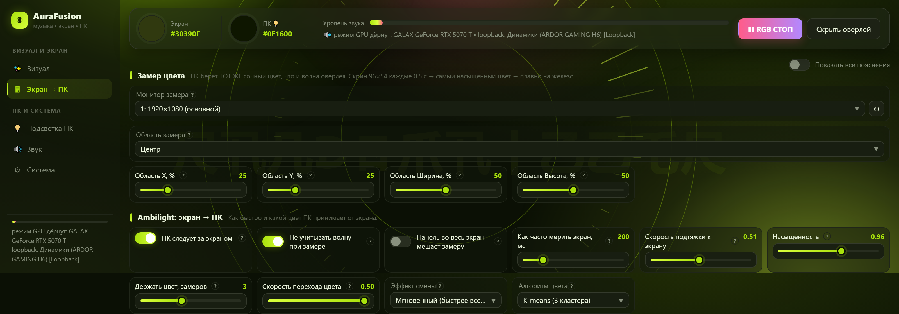
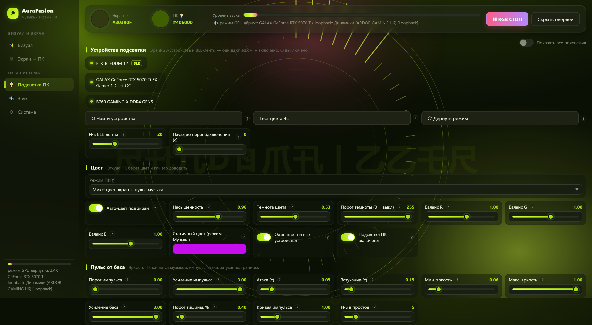
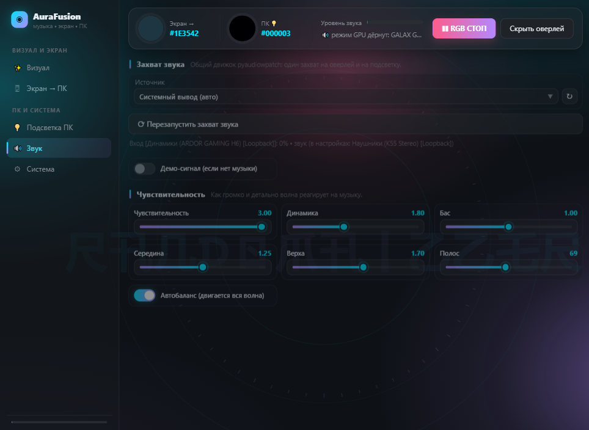
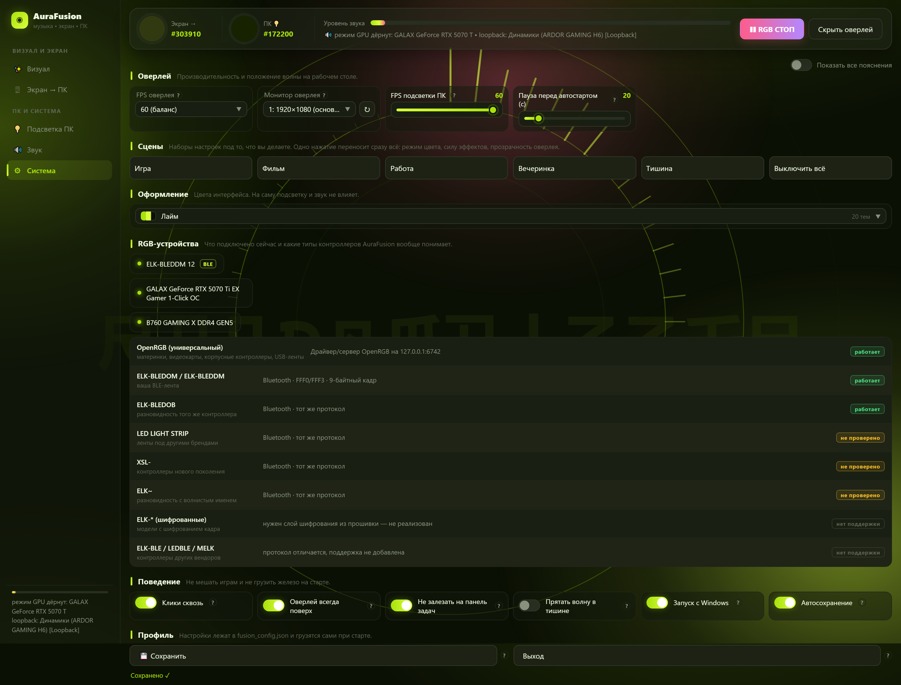
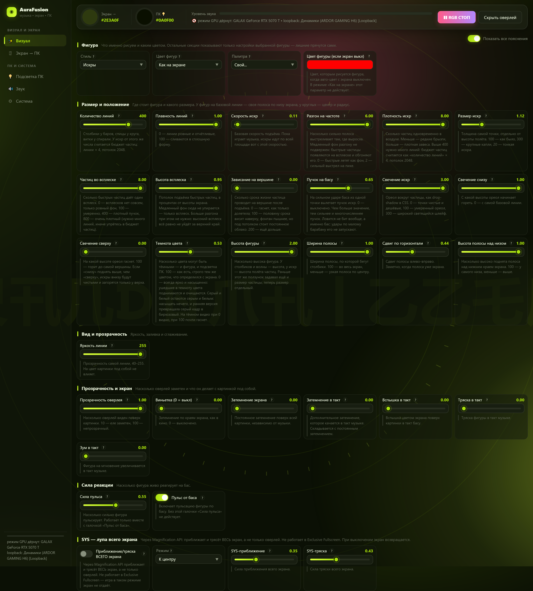
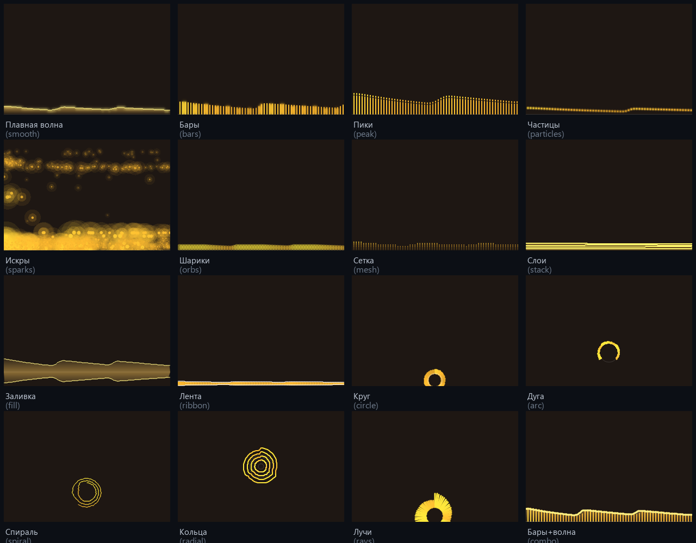

<div align="center">

# AuraFusion

**Подсветка ПК и оверлей, которые живут музыкой и картинкой**

Звук снимается прямо с выхода колонок, цвет — с пикселей экрана.
Всё это уходит в RGB-подсветку корпуса (OpenRGB), Bluetooth-ленту, адресную ленту Skydimo
и в оверлей с искрами поверх игр и рабочего стола.

`Windows 10/11` · `Python 3.10+` · `без облаков, аккаунтов и подписки`



</div>

> **English in short.** AuraFusion is a Windows app that turns system audio (WASAPI loopback) and
> screen colour into lighting: OpenRGB devices, ELK-BLEDOM/BLEDDM Bluetooth strips, Skydimo
> addressable strips (screen-mirror colours, music-driven brightness) and a click-through
> particle/spectrum overlay. Control panel runs in the browser at `http://127.0.0.1:8765/`.
> Quick start: `pip install -r requirements.txt`, then `start_aurafusion.bat` or `python web_main.py`.
> The UI and docs are in Russian.

---

## Содержание

- [Что умеет](#что-умеет)
- [Быстрый старт](#быстрый-старт)
- [Устройства](#устройства)
- [Лента Skydimo](#лента-skydimo)
- [Панель управления](#панель-управления)
- [Оверлей и искры](#оверлей-и-искры)
- [Настройки](#настройки)
- [Если что-то не работает](#если-что-то-не-работает)
- [Как это устроено](#как-это-устроено)
- [Разработка и проверки](#разработка-и-проверки)
- [Ограничения](#ограничения)

---

## Что умеет

| | |
|---|---|
| **Оверлей** | 16 стилей поверх окон (искры, бары, волна, круг, спираль…). Клик сквозь окно, любой монитор, не мешает играм. |
| **Экран → ПК** | Ambilight без захвата окна: цвет берётся с пикселей любого экрана, любой игры. Три алгоритма, выбор области, сглаживание. |
| **Подсветка ПК** | Всё, что видит [OpenRGB](https://openrgb.org): материнка, видеокарта, вентиляторы, ленты. Яркость качается от баса. |
| **Bluetooth-лента** | `ELK-BLEDOM` / `ELK-BLEDDM`: работает без OpenRGB, 15+ кадров в секунду. |
| **Лента Skydimo** | Цвет по краям экрана считает сама Skydimo, а AuraFusion качает яркость в такт музыке. |
| **Детектор темпа** | Автокорреляция по спектру (60–190 BPM): искры и пульс бьют по ритму, а не по порогу громкости. |
| **Панель в браузере** | 6 страниц, 20 тем, сцены («Игра», «Фильм», «Работа»…), журнал ошибок, значок состояния в трее. |

Источники цвета смешиваются в трёх режимах: `mix` (цвет с экрана + пульс музыки),
`screen` (только экран) и `music` (постоянный цвет + пульс музыки). Для видеокарты и
Bluetooth-ленты источник можно выбрать отдельно.

---

## Быстрый старт

Нужен Windows и Python 3.10 или новее.

```bat
git clone https://github.com/RANDOMAIZZ/aurafusion.git
cd aurafusion
pip install -r requirements.txt
start_aurafusion.bat
```

`start_aurafusion.bat` делает всё сам:

1. находит Python и ставит зависимости;
2. находит Skydimo (если установлена) и запускает её **тихо, без окна**;
3. гасит прошлый экземпляр AuraFusion (только его) и запускает новый;
4. ждёт, пока панель ответит.

```bat
start_aurafusion.bat                 обычный запуск
start_aurafusion.bat --no-browser    не открывать браузер
start_aurafusion.bat fast            не проверять зависимости
start_aurafusion.bat stop            остановить
```

Без батника: `python web_main.py [--port 8765] [--host 127.0.0.1] [--no-browser]`.
Панель откроется на **http://127.0.0.1:8765/**. Закрыть программу можно через значок в трее
(правый клик → «Остановить всё»).

**OpenRGB ставить необязательно.** Без него работают оверлей, Bluetooth-лента и Skydimo.
Если OpenRGB лежит не в обычном месте, укажите путь на странице «Подсветка ПК» → «OpenRGB» (`openrgb_path`)
(или переменной окружения `AURAFUSION_OPENRGB`). AuraFusion сам поднимет его сервер на порту 6742.

### Зависимости

| Пакет | Зачем |
|---|---|
| `PySide6` | оверлей, значок в трее |
| `numpy` | FFT, анализ кадров |
| `pyaudiowpatch` | захват звука через WASAPI loopback |
| `openrgb-python` | общение с сервером OpenRGB |
| `bleak` | Bluetooth-ленты |
| `Pillow` | вспомогательные картинки |

---

## Устройства

| Устройство | Как подключается | Статус |
|---|---|---|
| Материнка, видеокарта, вентиляторы, USB-ленты | через OpenRGB | работает |
| ELK-BLEDOM / ELK-BLEDDM (Bluetooth-ленты) | напрямую по BLE, без OpenRGB | работает |
| Skydimo SK0L27 (адресная лента) | через расширение для Skydimo | работает |
| LED LIGHT STRIP, XSL | по BLE | не проверялось |
| ELK~ с шифрованием, MELK | — | не поддерживаются |

Найти устройства можно на странице **Подсветка ПК → Найти устройства**. Для каждого задаются зона,
число светодиодов, цвет и «включено».

### Про видеокарты и водянки после перезагрузки

После загрузки ПК видеокарта и ARGB-колодка материнки иногда принимают режим `Direct` с
опозданием, и цвета «не доходят» до железа. AuraFusion лечит это сам:

- «пинает» режим у **всех** устройств OpenRGB (на другой и обратно в `Direct`);
- если Windows работает меньше 15 минут, пинки идут по расписанию (через 1, 9, 26, 61 и 121 секунду),
  иначе один раз при старте;
- устройство, которого ещё не было в OpenRGB при старте, подхватывается позже и тоже получает пинок;
- перед отправкой параметры режима приводятся к допустимым границам. Некоторые карты (проверено на
  GALAX GeForce RTX 5070 Ti) после загрузки отдают для `Direct` мусорные скорость и яркость, и без
  этого режим не выставляется вовсе.

Отключается настройкой `mode_kick`. Ручной пинок: страница **Подсветка ПК → Дёрнуть режим**.

---

## Лента Skydimo

Для Skydimo SK0L27 нужна программа Skydimo и небольшое расширение из этого репозитория
(`tools/skydimo_extension`). Оно получает от AuraFusion яркость и управляет лентой через
официальное API расширений Skydimo.

**Установка расширения**

1. Скопируйте `tools/skydimo_extension/init.lua` и `manifest.json` в папку
   `%APPDATA%\com.skydimo.desktop\plugins\dev\extension.aurafusion\`.
2. Запускайте Skydimo **в полном режиме**, не `skydimo-simple.exe`: в простом режиме расширения
   не загружаются. Тихий запуск без окна даёт `Launcher.exe --autostart-silent`, именно его использует
   `start_aurafusion.bat`.

**Два режима** (страница «Подсветка ПК» → «Лента Skydimo», настройка `skydimo_mode`)

| Режим | Что происходит |
|---|---|
| `mirror` (по умолчанию) | Расширение включает эффект `ScreenMirror`: цвет по краям экрана считает сама Skydimo, по её алгоритму, как в родной программе. AuraFusion меняет только яркость (3–100%) в такт музыке. |
| `solid` | AuraFusion красит все светодиоды одним цветом (тем же, что и остальные устройства). |

При закрытии AuraFusion яркость ленты возвращается на 100%, а `ScreenMirror` продолжает работать.

Протокол между расширением и AuraFusion: TCP `127.0.0.1:8766`, двоичный. Расширение шлёт 2 байта
(число светодиодов), дальше идут сообщения `'B' + яркость 0..100` или `'F' + leds×3 байт RGB`.
Расширение пишет свой журнал в `…\extension.aurafusion\data\aurafusion_ext.log`.

---

## Панель управления

Панель живёт в браузере и ничего не требует ставить: сервер на стандартной библиотеке, без
фреймворков и сборки.

| Страница | Что там |
|---|---|
| **Визуал** | Фигура, цвета, искры, свечение, пульс, тряска, зум, вспышка. Показываются только уместные для выбранной фигуры настройки. |
| **Экран → ПК** | Алгоритм цвета, область захвата, скорость, насыщенность, баланс белого. |
| **Подсветка ПК** | Устройства, режим `mix/screen/music`, яркость, пульс. |
| **Звук** | Устройство захвата, чувствительность, усиление баса/середины/верхов. |
| **Система** | Мониторы, производительность, автозапуск, сцены, тема. |
| **Логи** | Ошибки и предупреждения прямо в панели, без открытия файла. |

Горячие клавиши: `1`–`6` — страницы, `Пробел` — старт/стоп RGB. У каждой настройки есть знак «?» с
пояснением.

**Сцены** переключают сразу набор настроек: «Игра», «Фильм», «Работа», «Вечеринка», «Тишина»,
«Выключить всё». Сцены не трогают железо (устройства, порты, автозапуск), поэтому сценой нельзя
выключить подсветку не там.

**Сцены по приложениям.** На странице «Система» можно включить автопереключение: строки вида
`cs2.exe = game`, `vlc.exe = movie`, `* = work` (для всех остальных). Сцена меняется только при
смене активной программы, ручной выбор не сбивается.

**Значок в трее** показывает состояние тремя дугами: OpenRGB, лента, звук.
Зелёная — работает, жёлтая — подключается или частично, красная — не работает, серая — выключено.
Подсказка и верх меню дублируют это словами.

**Журнал.** Файл `aurafusion.log` ротируется (1 МБ × 3 копии), `crash.log` и вывод OpenRGB
отодвигаются при запуске. На странице «Логи» есть фильтры (ошибки / предупреждения / всё), источники
(приложение / падения / OpenRGB), счётчик одинаковых записей и кнопка «Копировать».

<details>
<summary>Скриншоты панели</summary>









</details>

---

## Оверлей и искры

16 стилей: `smooth`, `bars`, `peak`, `particles`, `sparks`, `orbs`, `mesh`, `stack`, `fill`,
`ribbon`, `circle`, `arc`, `spiral`, `radial`, `rays`, `combo`. У каждого свои размер, положение,
число линий и плавность; значения хранятся отдельно для каждой фигуры.

### Искры

Искры слушают спектр прямо из звукового движка — до авто-баланса и сглаживания, — и по каждой полосе
отдельно отличают ровный звук от удара (`core/onsets.py`):

- **Удар — пучок из своих частот, в тот же кадр.** Атака полосы — её прирост сверх собственного
  адаптивного порога (SuperFlux: прирост считается от соседних полос, поэтому свип и вибрато ударом
  не считаются). Бочка выстреливает слева, хэт справа, малый посередине. Число искр и высота — от
  силы удара; свежая искра удара горит белым и за ~0,2 с остывает до своего цвета.
- **Ровный звук — спокойный поток.** Поток и высота полосы растут с её уровнем. Тянущийся аккорд
  даёт ровное всплывание на своих нотах без всплесков; тишина — ничего, а уже летящие искры
  догорают за ~0,25 с.
- **Громкость трека видна.** Уровень меряется от медленной опоры (растёт за ~8 с, спадает за ~30 с),
  а не от текущего пика: тихий куплет остаётся ниже громкого припева.
- **Пучок на басу.** Сильный удар баса в громком месте трека — плотный широкий веер из точки удара.
- **Чуть хаоса.** У каждой искры свой разлёт вбок и своё покачивание в полёте («Хаос разлёта»),
  поэтому фонтан колышется, как искры над костром, а не летит по линейке.
- **Летят как искры над костром.** Резкий старт, торможение о воздух по экспоненте и лёгкое
  всплывание — скорость меняется плавно, без вершины и излома. Высота у каждой своя (логнормальный
  разброс), поэтому искры не выстраиваются в горизонтальные полосы. Полёт считается по формуле от
  момента вылета и не зависит от fps; таймер оверлея точный, кадры идут ровно.
- **Гаснут плавно.** Яркость и размер спадают на протяжении всего полёта, а не в конце. Короткие
  паузы в музыке искры не гасят — догорать быстрее они начинают только после ~0,35 с тишины.
- **Свет складывается.** Ядра рисуются сложением света: где искр много, фонтан раскаляется к белому.
  Ореол и ядро — мягкие гауссовы спрайты без колец, кэшируются по цвету.

Звуковой движок читает звук шагом в четверть блока и считает спектр по скользящему окну: свежий спектр
приходит каждые ~11 мс вместо 43 мс, разрешение по частоте прежнее.

Основные ручки: чувствительность, скорость, разгон (насколько сильный удар резче слабого), плотность,
размер, частиц во всплеске, высота всплеска над фоном, пучок на басу, хаос разлёта, затухание,
свечение
(с окном по высоте полёта), след.
Бюджет частиц — «количество линий» × 4 (до 2048); на 1080p и 60 fps комфортно примерно до тысячи искр.

### Цвет

- `shape_color`: `screen` (как на экране), `tint` (палитра, подкрашенная экраном), `palette`.
- **Темнота цвета** (`color_dark`): пол по яркости и насыщенности и для фигур, и для подсветки.
  Серый остаётся серым, подъём идёт только у уже цветных кадров.

---

## Настройки

Всё лежит в `fusion_config.json`. Файл создаётся сам при первом запуске; образец со значениями по умолчанию лежит в
`fusion_config.example.json`, а полный список ключей с комментариями — в
[`core/config.py`](core/config.py). Файл ведёт копию `fusion_config.json.bak` и пишется атомарно.

```jsonc
{
  "rgb_enabled": true,
  "rgb_mode": "mix",              // mix | screen | music
  "rgb_fps": 30,
  "follow_screen": true,          // главный тумблер «Экран → ПК»
  "color_algo": "juicy",          // juicy | average | kmeans
  "min_brightness": 0.02,
  "max_brightness": 1.0,
  "dark_threshold": 0,            // порог темноты подсветки, 0 = выкл
  "startup_delay_s": 20,          // пауза перед стартом RGB (ПК ещё загружается)
  "mode_kick": true,              // пинки режима Direct (см. выше)
  "skydimo_mode": "mirror",       // mirror | solid
  "ble_enabled": true,
  "openrgb_host": "127.0.0.1",
  "openrgb_port": 6742,
  "openrgb_path": "",             // путь к OpenRGB.exe, если он не в обычном месте
  "web_theme": "neon"
}
```

Значения из панели приводятся к нужным типам и диапазонам и при приёме, и при загрузке, так что
правка в конфиге или кривой запрос не могут сломать запуск.

---

## Если что-то не работает

| Симптом | Что проверить |
|---|---|
| Нет звука в оверлее | Страница **Звук**: выберите устройство захвата вручную. Захват идёт с выхода колонок (loopback), микрофон не нужен. |
| Видеокарта или водянка не горят после перезагрузки | Нажмите **Дёрнуть режим**; в журнале ищите `rgb: режим Direct выставлен`. Расписание пинков включается, если Windows работает меньше 15 минут. |
| Лента Skydimo красится не так, как нужно | Skydimo запущена в полном режиме (не `skydimo-simple.exe`)? В `extension.aurafusion\data\aurafusion_ext.log` должна быть строка `connected to AuraFusion`. |
| Лента Skydimo не реагирует на звук | Тот же журнал; режим `skydimo_mode` должен быть `mirror`. |
| Bluetooth-лента «занята» | У ленты одно BLE-соединение: закройте приложение на телефоне. |
| Цвет с экрана «замёрз» | Панель на весь экран закрывает замер — смотрите в панели предупреждение. Игры в эксклюзивном полноэкранном режиме иногда отдают чёрный кадр; помогает режим «без рамки». |
| Окно PowerShell изредка мелькает | Все дочерние процессы AuraFusion запускаются без окна; если окно появляется, значит, оно от другой программы. |
| Ошибки в работе | Страница **Логи** в панели или `aurafusion.log`. |

---

## Как это устроено

```
 звук  ───▶ audio_engine ─┬─▶ оверлей (ui/overlay.py)
                          └─▶ rgb_engine ─┬─▶ OrgbSink  → OpenRGB (материнка, видеокарта…)
 экран ───▶ screen_color ─┘               ├─▶ BleSink   → Bluetooth-лента
                                           └─▶ Skydimo   → расширение (яркость / кадры)
 панель:   webui/ (браузер) ◀──HTTP + SSE──▶ web_main.py
```

| Файл | Роль |
|---|---|
| `web_main.py` | точка входа: HTTP + SSE, ядро приложения, сторожа, запуск всего |
| `core/audio_engine.py` | WASAPI loopback → FFT → полосы, уровень, бас |
| `core/screen_color.py` | цвет с экрана (`juicy`, `average`, `kmeans`), сглаживание |
| `core/rgb_engine.py` | общий конвейер цвета и яркости, пинки режима, приёмники устройств |
| `core/beat.py` | детектор темпа и фазы доли |
| `core/ble_strip.py` | протокол и транспорт BLE-ленты (`7E LEN CMD … EF`, сервис `FFF0`) |
| `core/skydimo_ext.py` | TCP-сервер для расширения Skydimo |
| `core/capture.py` | захват экрана через DXGI (dxcam), сэмпл кадра |
| `core/openrgb_raw.py` | быстрые кадры в OpenRGB напрямую по протоколу |
| `core/scenes.py` | готовые сцены и фильтр безопасных ключей |
| `core/app_scenes.py` | сцены по активному приложению |
| `core/autostart.py` | автозапуск через реестр |
| `ui/overlay.py` | оверлей: окно, замер цвета, 15 стилей фигур |
| `ui/sparks.py` | стиль «искры»: физика частиц и отрисовка |
| `ui/tray.py` | значок в трее с цветом состояния |
| `core/status.py` | состояние OpenRGB, ленты и звука |
| `core/logs.py` | пути журналов, ротация, чтение для страницы «Логи» |
| `core/openrgb_launcher.py` | поиск и запуск сервера OpenRGB |
| `webui/` | панель: чистые HTML, JS и CSS |
| `tools/` | стенды и проверки, расширение для Skydimo |

Несколько решений, которые стоит знать:

- **Физика искр живёт в `tick()`, а не в `paintEvent`.** Иначе, когда Qt не перерисовывает окно
  (оверлей скрыт или свёрнут), искры замирают, а потом срываются разом.
- **Вызовы Qt из потоков HTTP идут через мост** (`GuiBridge`): трогать виджеты не из главного потока
  нельзя, сервер после этого просто перестаёт отвечать.
- **Кадры BLE уходят без подтверждения** (~1 мс против ~130 мс), раз в 2,5 с идёт кадр с подтверждением
  как пинг связи.
- **Сборщик мусора настроен** (`gc.freeze`, редкие сборы): долгий проход держит GIL, и панель
  могла замирать на секунды.

---

## Разработка и проверки

Проверено на Windows 11, Python 3.14, материнка B760 GAMING X DDR4 GEN5, GALAX GeForce RTX 5070 Ti,
BLE-лента ELK-BLEDDM, лента Skydimo SK0L27.

Автотесты ядра (конфиг, детектор темпа, цвет, захват, журнал, режимы OpenRGB) —
они же гоняются на GitHub при каждом push:

```bat
pip install pytest
python -m pytest -q
```

Оверлей можно проверить без экрана: рендер идёт через offscreen-платформу Qt, звук заменён синтетикой.

```bat
python tools\shot_overlay.py        листы со всеми стилями и линиями, поиск исключений в paintEvent
python tools\probe_sparks.py        искры: фон, разгон на своей частоте, плотность
python tools\probe_sparks_reaction.py  реакция искр на синтетический трек: задержка, попадания,
                                     частотная зона, динамика, тишина, слои (--shots ПАПКА — кадры)
python tools\probe_sparks_smooth.py  ни одна искра не пропадает, пока видна
python tools\probe_beat.py          детектор темпа на синтетике с заданным BPM
python tools\probe_beat_live.py     попадание ударов в ритм внутри настоящего tick()
python tools\probe_geom.py          геометрия оверлея и панели задач на живой машине
python tools\find_fadeout.py 10     поиск пропадающей фигуры на длинном сигнале
python tools\test_web_actions.py    панель: десять раз «скрыть/показать оверлей» и смена настроек
```

Стенды гоняют кадры по виртуальным часам: физика искр считается по времени, а кадры подряд идут
за доли миллисекунды.

---

## Ограничения

- **Только Windows**: WASAPI loopback, Win32 для замера экрана и оверлея.
- **Bluetooth-лента одноцветная**: прошивка не умеет красить отдельные пиксели, градиента по такой
  ленте не будет. Это ограничение железа. Адресная лента Skydimo градиент по краям экрана умеет.
- Лента держит одно BLE-соединение, пока открыт AuraFusion, приложение на телефоне её не займёт.
- Ленты с шифрованием кадра (`ELK~ шифрованные`, `MELK`) не поддерживаются.
- Количество искр ограничено производительностью: примерно тысяча на 60 fps при 1080p.
- Если на карте часть светодиодов (например, кулеры) не загорается и в родной программе
  производителя, это неисправность контроллера, программно она не лечится.
